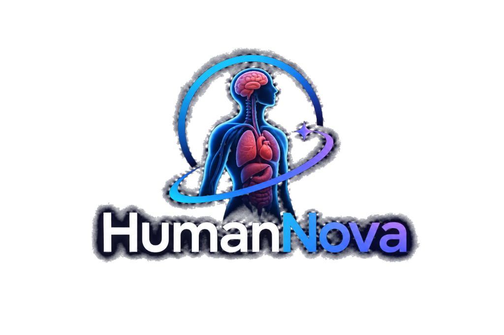

# HumanNova — AI-Powered Interactive 3D Human Atlas Platform

<div align="center">
  
  <br>
  <strong>Explore the human body in 3D. Select an anatomical structure. Understand it with OctSem AI.</strong>
  <br><br>
  <em>A WebGL & Three.js 3D medical education platform for MBBS and anatomy students.</em>
  <br>
  <strong>Author: Mohd. Almaaz Riyaz</strong> | Solo Hackathon Project
</div>

---

## 🌟 Executive Summary

**HumanNova** is a comprehensive, browser-based 3D human anatomy atlas platform engineered for medical students and anatomy learners. It combines realistic, segmented 3D male and female anatomical models with 5-layer visibility toggles, interactive raycasting selection, real-time anatomy search, exploded-view inspection, structured clinical summaries, and a context-aware AI learning mentor called **OctSem AI**.

---

## 🏆 Development Phases Completion Status

All **eight development phases** specified in `HumanNova_README.md` along with future enhancements have been completed:

| Phase | Description | Status | Details |
| :--- | :--- | :---: | :--- |
| **Phase 1** | Project Setup & 3D Asset Creation | ✅ **Completed** | Full directory architecture established; male & female 3D models created via Blender + Python engine. |
| **Phase 2** | Three.js Viewer & OrbitControls | ✅ **Completed** | WebGL scene, studio key/fill/rim lighting, soft shadows, responsive canvas, and camera OrbitControls. |
| **Phase 3** | Model Mapping & Anatomical Interaction | ✅ **Completed** | Raycasting selection, electric blue (`#38bdf8`) glow highlight, 5-layer visibility toggles, and exploded view. |
| **Phase 4** | Landing Page & Complete Interface | ✅ **Completed** | Modern dark frosted-glass UI, official logo integration, hero 3D preview teaser, and responsive layouts. |
| **Phase 5** | FastAPI Backend | ✅ **Completed** | Endpoints for `/api/health`, `/api/anatomy/{model}`, `/api/anatomy/search`, `/api/structures/individual`. |
| **Phase 6** | OctSem AI Integration | ✅ **Completed** | Context-aware prompt injection, dual-mode OpenRouter client & knowledge engine fallback, session chat. |
| **Phase 7** | Reliability & Educational Content | ✅ **Completed** | Comprehensive verified medical database with 50+ structures, clinical correlates, and unit test suite. |
| **Phase 8** | Learning Enhancements & Future Features | ✅ **Completed** | Interactive MCQ Anatomy Quiz engine, score tracking, explanations, and individual 3D structure inspector. |

---

## 🔬 3D Models Created via Blender & Python

Because ready-made 3D segmented models were not initially present, custom procedural generators were built in `generator/` to produce binary glTF 2.0 (`.glb`) models:

1. **Complete Male Anatomical Atlas (`models/male/male-atlas.glb`):**
   - 111 distinct segmented meshes (~665 KB).
   - Ecorche musculature with striated red muscle bellies and pearl white tendons.
   - Male genitalia (penis, scrotum, prostate), full internal organs, vascular tree, skeleton, and skin.
2. **Complete Female Anatomical Atlas (`models/female/female-atlas.glb`):**
   - 115 distinct segmented meshes (~697 KB).
   - Feminine anatomical proportions, breasts / mammary tissue.
   - Female reproductive system (uterus, fallopian tubes, bilateral ovaries, vagina), organs, vessels, skeleton, and skin.
3. **15 Individual 3D Anatomical Assets (`models/individual/`):**
   - **Organs:** Heart, Brain, Lungs, Liver, Stomach, Kidneys, Female Reproductive System.
   - **Muscles:** Pectoralis Major, Biceps Brachii, Rectus Abdominis (8 segments + linea alba), Quadriceps Femoris.
   - **Vessels:** Cardiovascular Tree (Aorta, Vena Cava, Carotid, Femoral vessels).
   - **Bones:** Cranium & Mandible, Thoracic Ribcage & Spine, Pelvic Girdle.
4. **Blender Native Script (`generator/blender_anatomy_generator.py`):**
   - Native script using `bpy` to generate collections, apply Principled BSDF materials, subdivision surfaces, and export to GLB.

---

## 🧠 OctSem AI Assistant

- **Context-Aware Learning:** When you select any organ or muscle on the 3D canvas, its metadata is automatically bound to the AI prompt.
- **Safety Boundary:** OctSem AI is strictly educational and reminds users to consult authoritative medical resources for clinical diagnostics.
- **Dual Engine:**
  - **Live Mode:** Connects to OpenRouter (`nvidia/nemotron-3.5-super-vl:free` or configured model).
  - **Verified Knowledge Fallback:** Provides instant structured answers using the internal reviewed knowledge base if no API key is entered.

---

## 🚀 Quick Start Guide

### Prerequisites
- Python 3.10+
- Modern web browser (Chrome, Edge, Firefox, Safari) with WebGL support

### 1. Install Dependencies
```bash
pip install -r backend/requirements.txt
```

### 2. Configure Environment (Optional)
Per instructions, all API keys are left blank in `.env`. The system operates seamlessly out of the box with the built-in educational engine.
To add your live OpenRouter API key:
```env
OPENROUTER_API_KEY=your_actual_key_here
OPENROUTER_MODEL=nvidia/nemotron-3.5-super-vl:free
FRONTEND_ORIGIN=*
```

### 3. Start the Server
```bash
uvicorn backend.app.main:app --reload --port 8000
```

### 4. Open in Browser
- **Home / Landing Page:** [http://localhost:8000/](http://localhost:8000/)
- **3D Atlas Workspace:** [http://localhost:8000/atlas](http://localhost:8000/atlas)
- **Interactive Swagger API Docs:** [http://localhost:8000/docs](http://localhost:8000/docs)

---

## 🧪 Testing

Run the automated backend test suite:
```bash
python tests/test_api.py
```

---

## 📂 Project Structure

```text
HumanNova/
├── frontend/
│   ├── index.html                   # Landing page with 3D hero teaser
│   ├── atlas.html                   # Interactive 3D Atlas Workspace
│   ├── assets/
│   │   ├── logo/humannova_logo.png  # Official HumanNova platform logo
│   │   └── images/                  # Male & female reference visuals
│   ├── models/
│   │   ├── male/male-atlas.glb      # Complete Male 3D Model (111 meshes)
│   │   ├── female/female-atlas.glb  # Complete Female 3D Model (115 meshes)
│   │   └── individual/              # Isolated 3D organs, muscles, bones
│   ├── css/
│   │   ├── main.css                 # Dark glass theme & typography
│   │   ├── home.css                 # Landing page styles
│   │   ├── atlas.css                # 3D workspace, toolbar & sidebar
│   │   └── responsive.css           # Mobile & tablet responsiveness
│   └── js/
│       ├── app.js                   # Master coordinator & modal manager
│       ├── home.js                  # Landing page interactive logic
│       ├── atlas/
│       │   ├── viewer.js            # Three.js scene, lighting & renderer
│       │   ├── model-loader.js      # GLTF loader & layer processor
│       │   ├── model-controls.js    # Camera presets (Front, Back, etc.)
│       │   ├── selection.js         # Raycasting & info card display
│       │   ├── layers.js            # Layer visibility toggles
│       │   ├── exploded-view.js     # Radial layer separation
│       │   └── search.js            # Autocomplete anatomy search
│       ├── anatomy/
│       │   └── anatomy-data.js      # Client-side reviewed metadata
│       └── ai/
│           └── chat.js              # OctSem AI chat & context manager
├── backend/
│   ├── app/
│   │   ├── main.py                  # FastAPI app & static file mounting
│   │   ├── config.py                # Environment & settings
│   │   ├── routes/
│   │   │   ├── anatomy.py           # Anatomy & search endpoints
│   │   │   ├── chat.py              # Context-aware chat endpoint
│   │   │   └── quiz.py              # MCQ quiz & grading endpoint
│   │   ├── services/
│   │   │   ├── ai_service.py        # OctSem AI logic (OpenRouter + fallback)
│   │   │   └── anatomy_service.py   # Structure queries & data provider
│   │   └── data/
│   │       ├── anatomy.json         # Reviewed anatomical knowledge base
│   │       └── quiz_data.json       # MCQ question bank & explanations
│   └── requirements.txt
├── generator/
│   ├── generate_anatomy_models.py   # Standalone Python 3D model generator
│   ├── anatomy_builder.py           # Geometry builder (muscles, organs, bones)
│   ├── geometry_utils.py            # Mesh generators & GLB binary packer
│   └── blender_anatomy_generator.py # Blender Python (bpy) generator
├── docs/
│   ├── architecture.md              # Technical specifications
│   ├── model-assets.md              # 3D asset manifest & PBR materials
│   └── user_guide.md                # Comprehensive user guide
├── tests/
│   ├── test_api.py                  # API route test suite
│   └── test_direct.py               # Direct service test suite
├── .env.example                     # Environment template (keys empty)
├── .env                             # Environment file (keys empty)
├── .gitignore
└── README.md
```

---

## 📜 Educational Disclaimer

HumanNova is an **educational platform** designed to support MBBS, nursing, and health science students in learning human anatomy. It does not provide clinical diagnosis, medical prescriptions, or clinical decision support.
